# ADR-0215 — Kind marks on grid tiles: one kind glyph, a duration and a state slot, from one atlas, spoken first

* **Status**: Accepted — 2026-10-21. The owner kept every decision
  (photolib-design#590,
  roadmap M1-36, photolib-design#495): the marked kinds (no HDR, edited, screenshot or portrait marks), the precedence,
  the corner slots, Material glyphs, the pill sizes and contrast, the 64 dp threshold, the switches per kind in
  Settings, the atlas painter, the screen-reader labels and the list view's text line.
* **Requirements**: R-APP-5, R-COMP-1. **Design**: docs/10 §3 (timeline), §4.3–4.4
  (Live, motion, panoramas), docs/17 §5, docs/02 FMT-06–09, FMT-13, FMT-15, VIEW-05, VIEW-38,
  docs/04 §4.4 (stacks).

## Context

The owner asked (2026-10-19) whether the grid will show that a tile is a video, a Live or motion photo, a panorama.
Today `_RowPainter` (`app/lib/features/library/timeline/timeline_row.dart`) draws a video's duration at the bottom end
on a black-54 % box, laid out with a `TextPainter` per video per paint, and a mark in the middle of a tile whose decode
failed; everything else looks like a plain photo. The design has badges only for stacks (docs/04 §4.4, M2),
availability (VIEW-05, M2-24), animated tiles (M1-32) and spatial media (FMT-15, M7-05). The data is there:
`local_asset` holds `mime`, `duration_ms`, `facets` (`motion_photo`, `panorama`, and PhotoKit's `live`, `hdr`,
`spatial`, `high_frame_rate`, `time_lapse`, `burst_cover`), `projection` and `favorite`; the `timeline_item` view the
painter pages does not select them yet, and nothing says whether a GIF or WebP is animated.

This record surveys 15 galleries, counts the complaints about marks, and proposes Photolib's marks. No product code
changes here; the last section is the task that builds it.

## Survey

One row per product, every cell with its source (keys under *Sources*; *no mark* is what the source shows, *not
found* is what no source settles). Corners are written for left-to-right layouts; *start* and *end* mirror.

| Product | Build | Live or motion | Panorama | 360° photo | 360° video | Video, duration | Slo-mo | Time-lapse | Burst or stack | GIF or animated | RAW | HDR | Spatial | Edited | Favourite | Shared | Cloud or local | Glyph or text | Corner | Size | Scrim | Small tiles | Switch off | Screen reader | Screenshot |
|---|---|---|---|---|---|---|---|---|---|---|---|---|---|---|---|---|---|---|---|---|---|---|---|---|---|
| Apple Photos | iOS 26 and macOS 26 user guides [ap1][ap5] | Mac: a badge, top-left; iOS: not found [ap5][ap1] | not found: a Panoramas album [ap7] | not found [ap7] | not found [ap7] | m:ss, bottom-right, no glyph [ap3] | not found: a Slo-mo album [ap7] | not found: a Time-lapse album [ap7] | one tile per burst; its mark not found [ap8] | not found [ap7] | not found [ap7] | not found [ap7] | not found [ap7] | no mark: an Edited collection [ap10] | heart, bottom-left [ap1][ap2] | Shared Library badge, top-right [ap4] | not found [ap1] | glyphs; duration text [ap2][ap3] | favourite bottom-left, duration bottom-right, shared top-right [ap2][ap3][ap4] | small: about a tenth of the tile (screenshot) [ap2] | none: white on the photo (screenshot) [ap3] | not found [ap1] | View Options › Shared Library Badge, that one only [ap1] | not found [ap1] | [shot](assets/0215/apple-photos.jpg) [ap2][ap3] |
| Google Photos | Android app, Play listing and help, 2026-10 [gp1] | not found [gp1] | not found [gp1] | not found: Android XR only [gp5] | not found: Android XR only [gp5] | play glyph and m:ss (2019) [gp4] | not found [gp1] | not found [gp1] | photo stacks; their mark not found [gp6] | not found [gp1] | "RAW" text, top-right (screenshot) [gp8] | no mark: the grid is SDR [gp7] | not found: Android XR only [gp5] | not found [gp1] | not found [gp1] | not found [gp1] | cloud-check (3 s after upload), cloud-slash, uploading, queued, failed; bottom-right [gp2][gp3] | glyphs; "RAW" text [gp2][gp8] | backup bottom-right, RAW top-right, duration top-right (2019) [gp2][gp8][gp4] | 18 dp backup glyph [gp2] | none: white on the photo [gp8] | not found [gp1] | not found for marks; stacks have a switch [gp6] | not found [gp1] | [shot](assets/0215/google-photos.jpg) [gp8][gp9] |
| Samsung Gallery | One UI 3 to 7, from two videos and help [sg1][sg2][sg3] | no distinct mark seen [sg1] | not found [sg3] | not found [sg3] | not found [sg3] | play glyph and m:ss on a dark pill, bottom-left [sg1] | not found [sg3] | not found [sg3] | not found [sg3] | not found [sg3] | not found [sg3] | not found [sg3] | not found [sg3] | not found [sg3] | red heart, top-right [sg1] | not found [sg3] | no tile mark: one cloud glyph in the bar [sg2] | glyphs; duration text [sg1] | duration bottom-left, favourite top-right [sg1] | the pill ≈ a quarter of the tile's width (screenshot) [sg1] | a dark pill behind the duration; the heart bare [sg1] | at 7 columns a play glyph without the duration [sg2] | not found [sg3] | not found [sg3] | [shot](assets/0215/samsung-gallery.jpg) [sg1][sg2] |
| OneDrive | iOS app 18.12.3 [od1] | "LIVE" in the viewer; on tiles not found [od2] | not found [od3] | the viewer pans; on tiles not found [od4] | not found [od4] | m:ss on a dark box, top-left [od1] | not found [od3] | not found [od3] | not found [od3] | not found [od3] | not found [od3] | not found [od3] | not found [od3] | not found [od1] | star, bottom-right [od1][od5] | no tile mark: "New" on shared albums [od6] | not found on the Photos grid [od3] | duration text; star glyph [od1] | duration top-left, favourite bottom-right [od1] | ≈ 12 pt text (screenshot) [od1] | a dark box behind the duration; the star bare [od1] | not found [od3] | not found [od3] | not found [od3] | [shot](assets/0215/onedrive.jpg) [od1] |
| Amazon Photos | iOS 12.10.0, Android listing 2026-10 [am3] | not found: plays as a still [am2] | not found [am1] | no mark: not supported [am1] | not found [am1] | not found on tiles [am3] | not found [am1] | not found [am1] | bursts kept; their mark not found [am1] | GIFs kept; their mark not found [am1] | RAW kept; its mark not found [am1] | not found [am1] | not found [am1] | no mark: an edit action only [am5] | heart, top-right, on hover (web) [am4] | in a group: the contributor's first name, top-right [am3] | not found on tiles [am6] | text: the contributor's name [am3] | name top-right [am3] | ≈ 11 sp text (screenshot) [am3] | none: shadowed text [am3] | not found [am1] | not found [am1] | not found [am1] | [shot](assets/0215/amazon-photos.jpg) [am3] |
| Synology Photos | Photos 1.9.1, apps 2.4.2 [sy5] | no tile mark: an icon in the viewer [sy2] | not found [sy3] | not found; the badge is seen on videos [sy1] | "360°" circle beside the duration, top-right [sy1] | m:ss and a play circle, top-right [sy1] | not found [sy3] | not found [sy3] | no mark: a Similar Items album [sy4] | not found [sy3] | not found [sy3] | not found [sy3] | not found [sy3] | not found [sy3] | added in 1.9.0; its mark not documented [sy5] | no tile mark: captions on shared albums [sy1] | app: six backup states, bottom-right [sy2] | duration text, play circle, "360°" [sy1] | kind top-right, backup bottom-right [sy1][sy2] | ≈ 12 % of the tile's height (screenshot) [sy1] | a faint dark gradient top-right [sy1] | not found [sy6] | not found [sy2] | not found [sy2] | [shot](assets/0215/synology-photos.jpg) [sy1] |
| Immich | v3.3.4, web and app; demo.immich.app [im8] | motion glyph, top-right (web 24 px, app 16 px) [im1][im3] | no mark: only equirectangular counts [im4] | web: 360 glyph, top-right; app: none [im1][im3] | no mark: the video branch wins [im1] | m:ss and a play glyph, top-right [im2][im3] | no mark [im1][im3] | no mark [im1][im3] | web: burst glyph and count; app: glyph only; top-right [im1][im3] | GIF glyph, top-right [im1][im3] | no mark (4 requests, see Complaints) [im1][im3] | no mark [im1][im3] | no mark [im1][im3] | no mark: the field is unused [im3] | heart, bottom-left [im1][im3] | web: owner's name, bottom-right [im1] | app: cloud, cloud-done or cloud-off, bottom-right [im3] | Material Design Icons; text for duration and count [im1][im3] | kind top-right, favourite bottom-left, storage bottom-right, select top-left [im1][im3] | web 24 px glyphs, 12 px text; app 16 px [im1][im3] | none: white with a drop shadow (app), a gradient on hover only (web) [im1][im3] | web drops the duration under 100 px and shrinks the glyph; app fixed [im2][im3] | app: "Show storage indicator" only [im6] | web alt "Video taken in Brussels, Belgium on January 31, 2025"; app nothing [im5][im3] | [shot](assets/0215/immich.jpg) [im8] |
| Ente | photos-v1.3.65, app and web [en1] | circle glyph, bottom-right [en1][en3] | no mark: the viewer only [en7] | no mark [en2][en3] | no mark [en2][en3] | duration in a rounded box, bottom-right [en1][en3] | no mark: no such type [en4] | no mark: no such type [en4] | no mark: RAW+JPEG pairs show nothing [en2] | no mark: no such type [en4] | no mark [en1][en3] | no mark [en1][en3] | no mark [en1][en3] | no mark [en1][en3] | heart, bottom-left (web: star at 60 %) [en1][en3] | owner's avatar, top-right [en1][en3] | app: cloud-off until uploaded, bottom-left [en1] | Material glyphs; duration text [en1][en3] | favourite and cloud bottom-left, kind bottom-right, owner top-right [en1][en3] | 16–24 px with tile width; web ≈ 20 px [en1][en3] | a corner gradient, black 14 % to clear [en1][en3] | glyphs shrink to 16 px under 75 px [en1] | no: grid size only [en6] | nothing: no label, no alt [en2][en3] | [shot](assets/0215/ente.jpg) [en5] |
| PhotoPrism | 261007-65faaae5d; demo 261020-8e724ef17 [pp7] | concentric-circles glyph, top-right, title "Live" [pp1] | no mark: an edit toggle only [pp5] | no mark: the viewer only [pp6] | no mark [pp6] | duration text, top-left; list view: play glyph [pp1][pp3] | not found [pp5] | not found [pp5] | burst glyph, top-right, title "Stack" [pp1] | GIF glyph, top-right, title "Animated" [pp1] | RAW glyph, top-right [pp1] | no mark: file details only [pp9] | not found [pp5] | no mark [pp5] | star on every tile, filled when favourite, bottom-left [pp1][pp7] | no mark [pp1] | no mark [pp1] | Material Design Icons with titles; duration text [pp4] | kind top-right, duration top-left, favourite bottom-left, select bottom-right [pp4] | 24 px glyphs in 28 px (mosaic) or 36 px (cards) buttons [pp4] | none: a text shadow [pp4] | never hidden: mosaic keeps every mark [pp2] | no: only the private lock follows a feature switch [pp8] | no alt (a CSS background); marks titled "Live", "RAW", "Stack" [pp1] | [shot](assets/0215/photoprism.jpg) [pp7] |
| Nextcloud Memories | v10.1.0; its demo runs 8.1.0 [nm6] | live glyph, top-right, 22 px [nm1] | no mark for flat panoramas [nm3] | sphere glyph, top-right [nm1] | no mark: the video branch wins [nm1] | h:mm:ss and a play glyph, top-right [nm1] | no mark [nm2] | no mark [nm2] | no count: RAW+JPEG pairs show RAW [nm1] | no mark [nm1] | RAW glyph, top-right, 28 px [nm1] | no mark [nm2] | no mark [nm2] | no mark [nm1] | star, bottom-right [nm1] | owner's name or "Shared", bottom-left [nm1] | Android app: cloud-off for local-only, bottom-right [nm1] | Material Design Icons; duration and owner text [nm1] | kind top-right, favourite bottom-right, owner bottom-left, select top-left [nm1] | 22 px glyphs, RAW 28 px, ≈ 12 px text [nm1] | none: white on the photo, lost on a bright frame (screenshot) [nm1][nm6] | fixed size; the inset shrinks on narrow screens [nm1] | "Show photo owner name on timeline" only [nm4] | nothing: an empty alt [nm5] | [shot](assets/0215/nextcloud-memories.jpg) [nm6] |
| Piwigo | 16.4.0 and Bootstrap Darkroom 2.4.4; demo1.piwigo.com [pw5] | not found [pw1] | not found [pw1] | not found [pw1] | not found [pw1] | no mark; a plugin adds one [pw1][pw6] | not found [pw1] | not found [pw1] | not found [pw1] | no mark [pw1] | no mark [pw1] | no mark [pw1] | no mark [pw1] | no mark [pw1] | no mark; Darkroom has a hover bar for collections [pw2] | no mark [pw1] | no mark [pw1] | only a "recent" icon in the caption [pw1] | none: the caption sits under the tile [pw3] | no marks; 160 × 90 thumbnails [pw1] | none; Darkroom's hover bar is black 60 % [pw4] | nothing to hide [pw3] | the caption, in the admin's configuration [pw1] | alt = the photo's title [pw1][pw5] | [shot](assets/0215/piwigo.jpg) [pw5] |
| LibrePhotos | 1.4.0 [lp4] | running-figure glyph and duration, bottom-right [lp1] | not found [lp7] | not found [lp7] | not found [lp7] | play glyph and mm:ss, bottom-right; a centred play on a still frame [lp1][lp4] | not found [lp7] | not found [lp7] | stack glyph and count, bottom-left [lp2] | no mark: a GIF is an image [lp7] | "RAW" text badge, bottom-left [lp2] | "HDR" badge on HDR videos, bottom-right [lp1] | not found [lp7] | no mark [lp7] | gold star or "4 ★", top-right [lp3] | no mark [lp4] | no mark [lp4] | Tabler glyphs; "RAW" and "HDR" badges [lp6][lp2] | favourite top-right, RAW and stack bottom-left, video bottom-right, select top-left [lp5] | 18 px glyphs, 10 px badge text [lp6] | a drop shadow; a grey box behind text badges [lp5] | never hidden [lp4] | the rating style only [lp8] | "Video taken <date>", "HDR video …"; RAW not said [lp4] | [shot](assets/0215/librephotos.png) [lp1] |
| Aves | v1.15.7 [av1] | motion-photo glyph [av1] | the panorama glyph, as 360° [av1] | panorama glyph [av1] | 360 glyph instead of play [av2] | play glyph and duration [av2] | slow-motion glyph instead of play [av2] | no mark [av7] | burst glyph and count [av2] | animated glyph [av1] | RAW glyph [av1] | HDR glyph [av1] | not found [av7] | no mark [av7] | favourite glyph [av1] | not found [av1] | no mark: local only [av7] | Material Symbols; duration and count text [av4] | every mark in one column, bottom-start [av3] | min(24, tile ÷ 5 − 1) dp: 8–24 dp [av1][av6] | a pill per mark: black 67 % (dark) or white 80 % (light) [av2] | never hidden: 8 dp glyphs on 46 dp tiles [av1][av6] | Settings › Thumbnails › Overlay, a switch per mark [av5] | nothing: no semantics [av8] | [shot](assets/0215/aves.jpg) [av9] |
| Fossify Gallery | 1.14.0 [fg1] | no mark: requested in #59 [fg5] | no mark: the viewer only [fg6] | no mark [fg5] | no mark [fg5] | play glyph and mm:ss on a pill, top-start [fg1][fg3] | no mark [fg5] | no mark [fg5] | no mark [fg5] | "GIF" text, top-start [fg1] | "RAW" text, top-start [fg1] | no mark [fg1] | not found [fg5] | no mark [fg5] | star in a circle, bottom-end [fg2] | no mark [fg5] | no mark [fg5] | vector glyphs; "GIF", "RAW", "SVG" and duration text [fg2][fg3] | type and duration top-start, favourite bottom-end [fg2] | 26 dp boxes, 16 sp type, 14 sp duration, fixed [fg8] | a pill or circle, black 40 %; type text shadowed only [fg7] | never hidden, fixed size [fg1] | "Change file thumbnail style": durations, file types, favourites [fg4] | the text views' text only ("GIF", "02:34") [fg2] | [shot](assets/0215/fossify-gallery.jpg) [fg9] |
| Simple Gallery | 6.28.1, the last release [sm1] | no mark [sm1] | no mark: the viewer only [sm5] | no mark [sm1] | no mark [sm1] | play glyph and mm:ss, top-start [sm1][sm3] | no mark [sm1] | no mark [sm1] | no mark [sm1] | "GIF" text, top-start [sm1] | "RAW" text, top-start [sm1] | no mark [sm1] | not found [sm1] | no mark [sm1] | star in a circle, top-end [sm2] | no mark [sm1] | no mark [sm1] | vector glyphs; "GIF", "RAW", "SVG" and duration text [sm2][sm3] | type and duration top-start, favourite top-end [sm2] | 26 dp boxes, 16 sp and 14 sp text, fixed [sm6] | none on the duration: a text shadow (screenshot) [sm3][sm7] | never hidden, fixed size [sm1] | "Change file thumbnail style": durations, file types, favourites [sm4] | the text views' text only [sm2] | [shot](assets/0215/simple-gallery.jpg) [sm7] |

What the survey shows:

* **Every product but Piwigo and Amazon marks a video, nearly always with its duration as text**: bottom-right in
  Apple, Ente and LibrePhotos; top-right in Immich, Memories, Synology and Google; top-left in OneDrive, PhotoPrism,
  Fossify and Simple Gallery; bottom-left in Samsung; at the bottom start, with every other mark, in Aves.
* **Live and motion photos** get a glyph in Immich, Ente, PhotoPrism, Memories, LibrePhotos, Aves and Apple's Mac app;
  no source shows one on the tiles of Apple's and Google's phone apps, Samsung, OneDrive or Synology, the last two
  marking them in the viewer.
* **Panoramas and 360°** are marked by Immich (web), Memories and Aves only, none of them telling a flat panorama from a
  sphere; Synology and Aves alone mark a 360° video, Synology with "360°" beside the duration
  ([screenshot](assets/0215/synology-photos.jpg)).
* **RAW** is the most requested missing mark (Complaints); Google, PhotoPrism, Memories, LibrePhotos, Aves and the two
  Simple galleries mark it, as a glyph or as "RAW" text ([Google](assets/0215/google-photos.jpg)).
* **HDR, slo-mo and time-lapse** are marked only by Aves (HDR, slow motion) and LibrePhotos (HDR video); Aves users ask
  to turn the HDR mark off because every photo has it ([Aves #859]).
* **Scrims vary and fail on bright photos**: Memories' white duration vanishes on a pale sky
  ([screenshot](assets/0215/nextcloud-memories.jpg), second crop), Simple Gallery's shadowed duration is unreadable on a
  white frame ([screenshot](assets/0215/simple-gallery.jpg)); Fossify fixed the same by adding a pill
  ([Fossify #7], [screenshot](assets/0215/fossify-gallery.jpg)).
* **Small tiles**: Immich (web) drops the duration under 100 px and Samsung at seven columns keeps only a play glyph
  ([screenshot](assets/0215/samsung-gallery.jpg), bottom crop); Ente and Aves shrink marks (Aves to 8 dp); the rest draw
  full-size marks on dense grids ([PhotoPrism's mosaic](assets/0215/photoprism.jpg), bottom crop).
* **Switches**: Aves (a switch per mark) and Fossify and Simple Gallery (three) let the user turn marks off; Apple
  hides only its Shared Library badge, Immich's app only its storage marks; the rest offer nothing.
* **Screen readers** hear the kind nowhere but in Immich's web alt text ("Video taken …") and LibrePhotos' labels;
  no commercial product documents what its tiles say.

### Screenshots

Each crop keeps only tiles. Apple Photos and Google's backup mark come from their help pages; OneDrive, Amazon,
Synology and Ente from their store listings; Immich, PhotoPrism, Memories and Piwigo from their public demos in headless
Chrome on 2026-10-21. Where no listing or help page shows a marked tile, a user's screenshot in a tracker or a how-to
video stands in: Google's RAW mark ([Immich D21029]), Samsung Gallery (two video frames), Aves, Fossify Gallery and Simple
Gallery (their own builds, in their trackers). LibrePhotos, whose demo is down and whose docs show no marked tile, is its
1.4.0 overlay components (`VideoOverlay`, `StackOverlay`, `TopRightOverlay`, `TileBadge`, the tile's corner CSS)
rendered on drawn tiles. Third-party images are quoted here to compare the products, with their sources; they are not
offered under this repository's licence.

| Product | Grid | What it shows |
|---|---|---|
| Apple Photos | 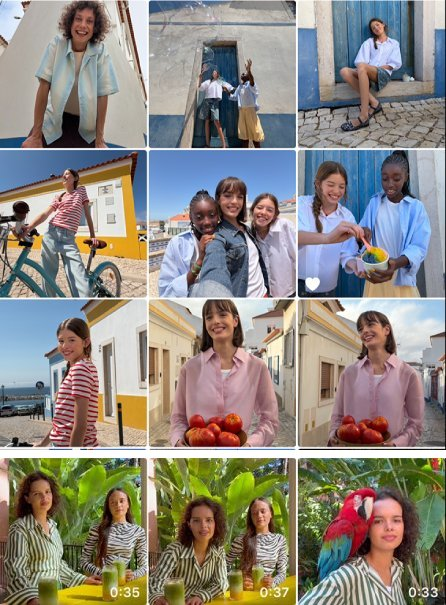 | a heart bottom-left; durations bottom-right, bare |
| Google Photos | 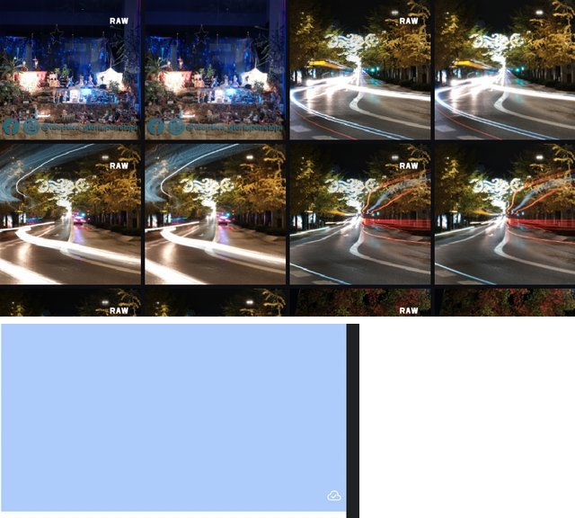 | "RAW" top-right; the backed-up cloud bottom-right |
| Samsung Gallery | 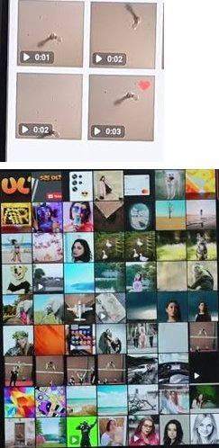 | duration pills bottom-left, a red heart top-right; at 7 columns play glyphs only |
| OneDrive |  | durations top-left on a dark box, stars bottom-right |
| Amazon Photos |  | the contributor's name top-right, in a group |
| Synology Photos | 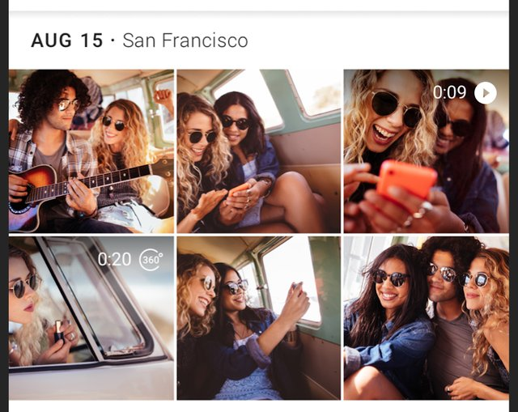 | duration and play top-right; "360°" beside a 360° video's |
| Immich | 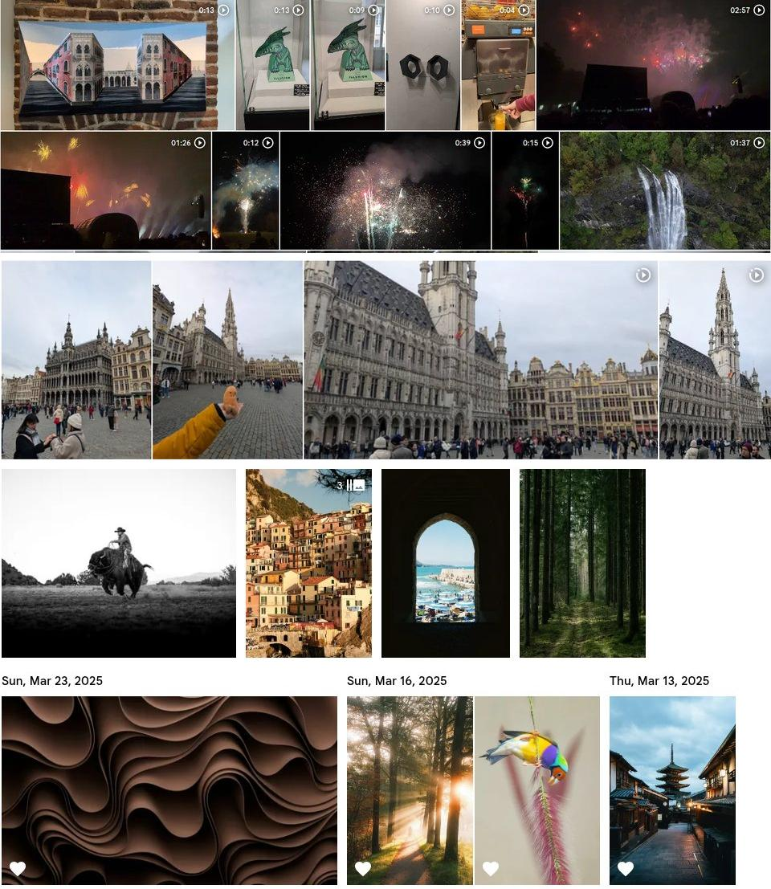 | durations, motion and stack glyphs top-right; hearts bottom-left |
| Ente | 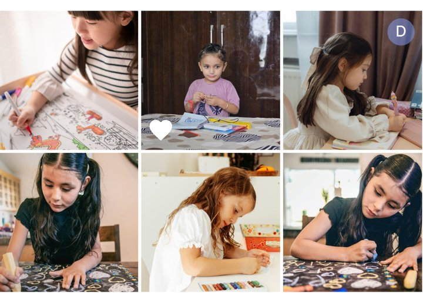 | a heart bottom-left, the owner's avatar top-right |
| PhotoPrism | 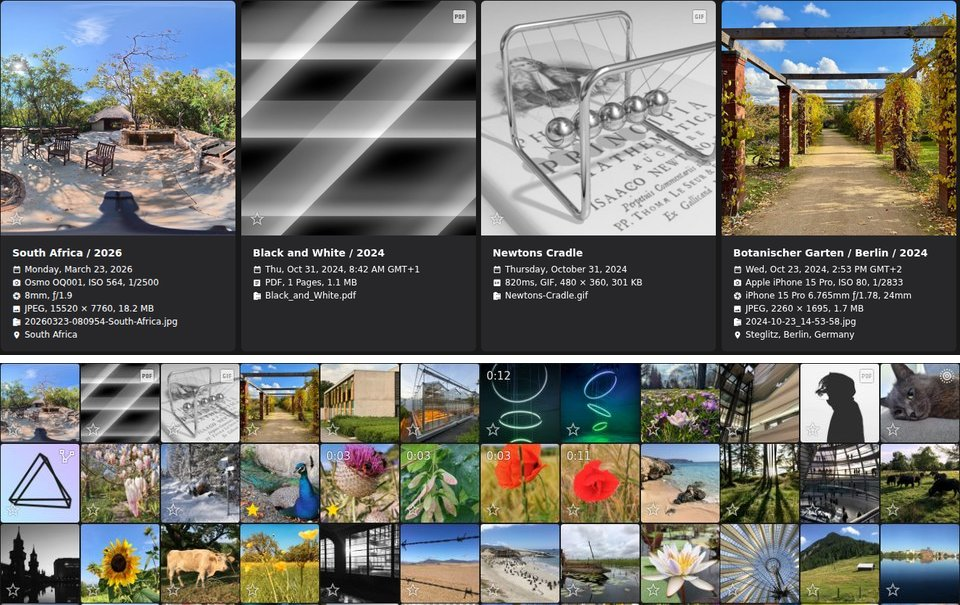 | duration top-left, kind top-right, a star on every tile; the same in the mosaic |
| Nextcloud Memories | 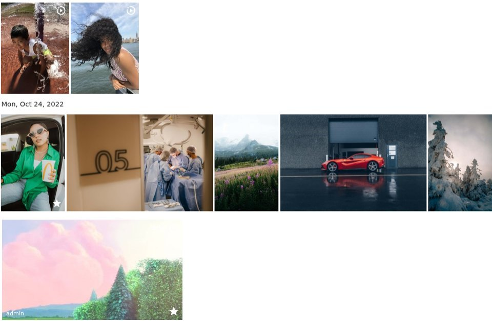 | live and RAW glyphs top-right; "9:56" lost on a pale sky |
| Piwigo | 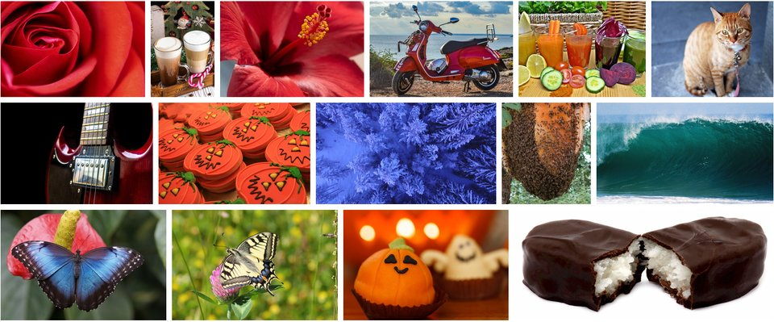 | no marks |
| LibrePhotos | 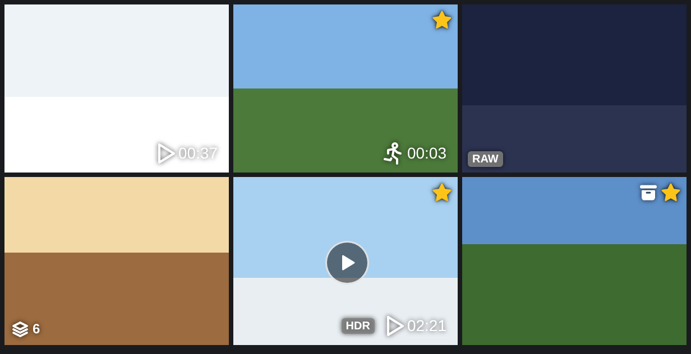 | duration and motion bottom-right, "RAW" and stacks bottom-left, stars top-right |
| Aves |  | play glyph and duration on a pill, bottom-start |
| Fossify Gallery | 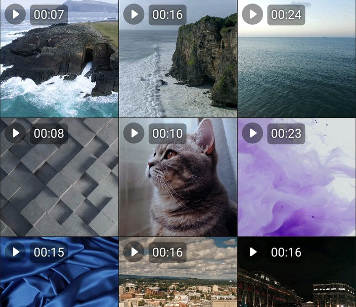 | play and duration on pills, top-start |
| Simple Gallery |  | play and duration with a shadow only, top-start |

## Complaints about marks

The issue corpus (research/issues, 17 trackers, downloaded 2026-10-15): threads whose title names a mark
(badge, icon, indicator, overlay, label, symbol) with a tile or a kind, or asks to tell kinds apart, 314 candidates,
read one by one; 79 are about marks on grid tiles. Votes are 👍 on issues and upvotes on discussions.

| Complaint | Threads | Votes | Threads (votes) |
|---|---:|---:|---|
| Missing: a kind is not marked — RAW 7, video or its duration 4, Live or motion 1, GIF 1 (with RAW), a stack in the list view 1 | 13 | 24 | [Immich D8027] (6), [Ente D6656] (5, GIF and RAW), [Ente D1770] (4, duration), [Immich D17011] (3, motion), [Immich D6267] (2), [Ente D12853] (2), [Immich D14852] (1), [LibrePhotos #308] (1), [Immich #24135], [PhotoPrism #467], [PhotoPrism #307] (list view), [Nextcloud Photos #417], [Ente #528] |
| Missing: who shared or owns it | 8 | 27 | [Immich D16144] (12), [Memories #955] (7), [Immich D15448] (4), [Immich D17143], [Immich D21653], [Immich D22731], [Immich D28332] (1 each), [Memories #479] |
| Missing: the favourite in other views | 2 | 4 | [Immich D11688] (3), [Immich D11899] (1) |
| Missing: availability (cloud-only, local-only, pending, downloaded) | 5 | 11 | [Ente D2829] (6), [Ente D12065] (2), [Ente D12392] (2), [Immich D17859] (1), [Memories #1535] |
| Missing: other facts (album membership, location, rating, tags, captions, resolution, size) | 11 | 60 | [Immich D1621] (46, in an album), [Immich D6190] (6), [Immich D31486], [Immich D23655], [Aves #1771], [Ente D6434] (2 each), [Aves #472], [Aves #1984], [Damselfly #426], [PiGallery2 #1047], [Fossify #970] |
| Wrong: a mark on the wrong items, stale, or a switch ignored | 21 | 17 | Immich's storage marks: [Immich #22366] (6) and [Immich #20139] (4) ignore the switch off, [Immich D23335] (2), [Immich #22573] (1), [Immich #20249], [Immich #571], [Immich #14548], [Immich #18625], [Immich #20955], [Immich #22564], [Immich #23252], [Immich #24652], [Immich #28795]; [Immich #26181] (2, video glyph on photos), [Immich #18828] (1, stack lost), [Immich #17663], [Immich #21968] (favourite); [Memories #1402], [Memories #1417] ("Shared" on every tile); [Aves #2219] (motion mark only once played); [PhotoPrism D4040] (1, stack glyph on every converted HEIC) |
| Cluttered: too big, over other marks or the interface | 4 | 0 | [Aves #68], [Aves #240] (too big), [Fossify #428] (favourite under the selection mark), [Immich #18575] (play glyphs over the search dialog) |
| Unreadable or unclear: contrast, size, meaning | 8 | 5 | [Immich D25347] (2, too subtle), [Immich D22136] (2, meanings), [PhotoPrism D2765] (1, "what is a live video?"), [Fossify #7] (duration on bright frames), [Immich #10213] and [Nextcloud Photos #3472] (white or low-contrast glyphs), [Memories #898], [LibrePhotos #2243] (sizes) |
| Switch off or choose marks | 6 | 33 | [Immich D21029] (24, configurable marks), [Immich D26394] (3, cloud), [Immich D20980] (2), [Immich D22273] (2), [Immich D22747] (1, Live: "all of my photos are live"), [Aves #859] (1, HDR: "all of my photos are HDR") |
| Screen reader: unnamed marks | 1 | 0 | [LibrePhotos #2245] |
| **All** | **79** | **181** | |

Outside the corpus the trackers the survey read say the same: Simple Gallery's duration is unreadable on white
([Simple Gallery #1719], [Simple Gallery #2729]) and slows scrolling ([Simple Gallery #1097], [Fossify #505]).

The review study (research/reviews, 5,576 Play reviews of five apps, 2026-10-19), read for marks:

| Complaint | Reviews | Helpful | Reviews (helpful) |
|---|---:|---:|---|
| No name on video tiles: "you have to guess which video" | 10 | 473 | InShot, per its report (#37) |
| A mark lost by an update (the lock on locked pictures) | 1 | 333 | InShot #341 |
| A "GIF" word instead of animating every tile | 1 | 57 | PhotoZen #222 |
| A wrong duration (00:00, or over an hour) | 3 | 49 | Simple Gallery #478 (24), #796 (1); InShot #151 (24) |
| No favourite mark on tiles | 2 | 5 | PhotoZen #339 (5), InShot #836 |
| No album-membership mark | 1 | 3 | Immich #421 |
| No upload or backup state on tiles | 2 | 2 | Synology #193 (2), #236 |
| **All** | **20** | **922** | |

Taken together: users ask for RAW, video durations and motion first; they turn marks off when a mark is on nearly
every item (Live on an iPhone, HDR on a recent phone, a cloud on a backed-up library); and marks that are wrong cost
more trust than marks that are missing — 21 of the 79 threads, nearly all of them availability marks.

## Decision

We will draw at most one kind glyph, one duration and one state pill on a tile, each in its own corner, on its own dark
pill, from one pre-rasterised atlas inside the row painter, hidden on tiles under 64 dp and always spoken.

### Kinds

Marked: video (its duration), Live and motion photos (one kind: they move on a press), 360° photos and videos,
panoramas (GPano crops, PhotoKit panoramas), animated images (GIF, WebP, APNG, AVIF with more than one frame), RAW
(alone or as the RAW of a RAW+JPEG pair), slow-motion and time-lapse videos (PhotoKit's facets), spatial photos and
videos (FMT-15, when M7-05 reads them), and stacks with their count (bursts, series, brackets; docs/04 §4.4, M2). Not
marked: HDR, edited, screenshots, portraits.

* **Alternative**: mark everything the file says, as Aves does ([screenshot](assets/0215/aves.jpg)) with HDR, location,
  tags and rating; or only videos and favourites, as Apple Photos ([screenshot](assets/0215/apple-photos.jpg)), with
  Piwigo marking nothing at all ([screenshot](assets/0215/piwigo.jpg)).
* **Why**: a mark says what opening the tile will do differently — play, move, look around, page through a stack — or,
  for RAW, what the file is, the most requested missing mark (7 threads). HDR is on nearly every recent photo and the
  grid shows SDR anyway: Aves' users turn it off ([Aves #859]); the viewer has the HDR toggle (ADR-0060). Edited has
  not one request in the corpus and no surveyed product marks it.

### Precedence

One kind glyph per tile, the first that applies: stack (with its count) › 360° › spatial › panorama › Live or motion ›
animated › slow motion › time-lapse › RAW. A video's duration and a tile's state never compete with it: they have
their own slots, so a 360° video shows the 360° glyph and its duration, a favourite RAW the RAW glyph and the heart.

* **Alternative**: every mark that applies, side by side, as Aves stacks a column of pills
  ([screenshot](assets/0215/aves.jpg); "too big", [Aves #68], [Aves #240]) and PhotoPrism a row of buttons
  ([screenshot](assets/0215/photoprism.jpg)); or the first branch of the code wins, as Immich and Memories lose a 360°
  video's sphere to its play glyph.
* **Why**: one glyph fits a 64 dp tile; the order puts first what changes the opening most and is rarest, and the
  screen-reader label still names every kind. A 360° video keeps both, as Synology shows "360°" beside the duration
  ([screenshot](assets/0215/synology-photos.jpg)).

### Slots

Four corners, mirrored in right-to-left layouts: **top-start** stays the selection ring (M1-10); **top-end** is the
kind (or a stack's glyph and count); **bottom-end** the duration, where it is today; **bottom-start** the state: the
favourite heart (M1-16) and, with M2-24, the availability glyph before it, at most two glyphs on one pill. The failed
decode keeps the centre.

* **Alternative**: kind and duration together top-right, as Immich, Memories and Synology do
  ([Immich](assets/0215/immich.jpg), [Memories](assets/0215/nextcloud-memories.jpg),
  [Synology](assets/0215/synology-photos.jpg)); everything in one corner, as Aves
  ([screenshot](assets/0215/aves.jpg)); type and duration at the top start, as Fossify and Simple Gallery
  ([Fossify](assets/0215/fossify-gallery.jpg)), where Photolib draws the selection ring and Fossify's favourite
  collided with its selection mark ([Fossify #428]).
* **Why**: one meaning per corner reads at a glance and leaves the selection ring alone; the duration stays where Apple
  Photos ([screenshot](assets/0215/apple-photos.jpg)) and Photolib's own grid put it, the heart where Apple, Immich and Ente
  do; M2-24 and stacks get slots now instead of fighting for one later.

### Glyphs

Flutter's Material Icons, which the app already ships: `motion_photos_on` (Live and motion), `threesixty` (360°),
`panorama_horizontal`, `gif_box` (animated), `raw_on`, `slow_motion_video`, `timelapse`, `view_in_ar` (spatial),
`filter_none` with the count (stack), `favorite`, and M2-24's cloud glyphs; the duration is text, `m:ss` or `h:mm:ss`
in tabular figures and the locale's digits (`formats.duration`). White on the pill in both themes.

* **Alternative**: words — "GIF", "RAW", "LIVE" — as Fossify, Simple Gallery and LibrePhotos print them
  ([LibrePhotos](assets/0215/librephotos.png), [Fossify](assets/0215/fossify-gallery.jpg)); or custom drawings, as
  PhotoPrism's and Memories' Live glyphs.
* **Why**: glyphs need no translation into 21 languages and keep one width; `gif_box` and `raw_on` still read as the
  words photographers know, as Google's "RAW" ([screenshot](assets/0215/google-photos.jpg)); Material's glyphs match
  the rest of the app (ADR-0037) and are the ones Immich's app and Aves use for the same kinds, so users of either
  recognise them.

### Sizes

On tiles from 64 dp to under 160 dp: a 16 dp glyph on a 20 dp pill, a 12 sp duration, 4 dp from the edges; from 160
dp: a 20 dp glyph on a 24 dp pill, 14 sp, 6 dp. Pills have a 4 dp radius and are black at 60 % (80 % in the
high-contrast theme), so white text keeps 5.7:1 on a white photo (WCAG 1.4.3 asks 4.5:1; today's 54 % gives 4.6:1).
The duration follows the system text scale up to 1.3×; the screen reader has the rest.

* **Alternative**: no scrim, white with a shadow, as Memories, Immich's app, LibrePhotos and Simple Gallery
  ([Memories' video tile](assets/0215/nextcloud-memories.jpg) shows "9:56" lost on a pale sky,
  [Simple Gallery](assets/0215/simple-gallery.jpg) "00:13" on white; [Fossify #7], [Immich #10213],
  [Nextcloud Photos #3472]); a corner gradient, as Ente ([screenshot](assets/0215/ente.jpg)); marks that scale with the
  tile without a floor, as Aves (8 dp).
* **Why**: a pill per mark is the only scrim that guarantees contrast on any photo while covering only the mark, as
  OneDrive and Samsung already put their durations on dark boxes ([OneDrive](assets/0215/onedrive.jpg),
  [Samsung](assets/0215/samsung-gallery.jpg)); two fixed steps keep marks crisp from one atlas.

### Hide threshold

No marks on tiles under 64 dp; the selection ring and the failed-decode mark stay. On phones that is the Months and
Years levels and Days at more than five columns on a 360 dp screen; on desktops a tile has to be that small.

* **Alternative**: never hide, as PhotoPrism's mosaic ([screenshot](assets/0215/photoprism.jpg), bottom crop),
  LibrePhotos and the Simple galleries draw full-size marks on dense grids; shrink without a floor, as Aves; drop only
  the duration, as Immich's web under 100 px and Samsung at seven columns ([screenshot](assets/0215/samsung-gallery.jpg)).
* **Why**: under 64 dp a 20 dp pill covers a third of the tile and nobody picks a video by its duration at that density;
  the threshold is a size, not a level, so a large desktop window keeps marks where a phone drops them.

### Setting

"Marks on tiles", on by default, in the grid's view menu next to M1-32's view options, with one switch per kind in
Settings › Library › Tile marks: durations, Live and motion photos, 360° and panoramas, animated images, RAW, slow motion
and time-lapse; stacks, availability and favourites join with M2 and M1-16. Stored with M1-32's view state in the
vault's sealed `settings` object, per device.

* **Alternative**: no setting, as Google, Samsung and OneDrive, or one badge only, as Apple; one master switch only; a
  switch per mark only, as Aves' nine ([Aves screenshot](assets/0215/aves.jpg)).
* **Why**: the most voted mark thread asks to choose marks ([Immich D21029], 24), and users turn off a kind that is on
  every item ([Immich D22747] for Live, [Aves #859] for HDR); one switch serves those who want a clean grid.

### Painter

`_RowPainter` draws the marks; no widget per tile (docs/10 §3.1). The row's page carries each item's mark (kind, stack
count, duration, state), computed when the page is read, never in `paint`. Every glyph of a size step, on its pill,
and the duration's digits and separator are rasterised once into one atlas image per device pixel ratio and text scale
(`PictureRecorder`, `toImageSync`); a row draws every kind and state sprite and every duration digit with one
`drawAtlas`, and its duration pills as one path with one `drawPath`: two draws a row, whatever the marks. The marks
have their own paints, never recoloured (M1-30): the pill paint and the atlas paint.

* **Alternative**: a widget stack per tile, as Immich's app (`thumbnail_tile.widget.dart`) and Ente's
  `FileIconsWidget` ([Immich](assets/0215/immich.jpg), [Ente](assets/0215/ente.jpg)); a `TextPainter` per duration per
  paint, as today; an image draw per mark.
* **Why**: the timeline holds 1 % janky frames over a million items (NFR-PERF-1); a layout per video per frame is what
  made durations slow in the Simple galleries ([Simple Gallery #1097], [Fossify #505]), and two draws a row cost the
  same at 3 or 16 columns.

### Screen-reader labels

A tile's label starts with its kind, then its place, as docs/17 §5 says ("photo 12 of 340, 3 May 2024"): "Live photo,
3 May 2024, 12 of 340"; the value stays the duration; a favourite adds "favourite", a stack "stack of 6", M2-24 its
availability. Every kind is spoken whether its mark is shown, hidden by size or switched off. Nouns: photo, video, Live
photo (motion photo on Android), 360° photo, 360° video, panorama, spatial photo, spatial video, animated image, RAW
photo, slow-motion video, time-lapse.

* **Alternative**: the date only, as Immich's web alt ("Video taken in Brussels, Belgium on January 31, 2025",
  [screenshot](assets/0215/immich.jpg)) and Photolib today; an empty alt, as Memories, Ente and Aves; a label per mark,
  as LibrePhotos' rating badge, one more stop per tile ([LibrePhotos](assets/0215/librephotos.png)).
* **Why**: one stop per tile with the kind first is what a sighted user gets from the glyph; settings for sight must not
  silence the screen reader ([LibrePhotos #2245]).

### List view

VIEW-38's list (M1-15) puts no marks on its small thumbnails; the row's second line starts with the kind's glyph and
noun, then the duration, date and size: "▶ Video · 0:37 · 3 May 2024 · 24 MB".

* **Alternative**: the grid's marks on the list's thumbnail, as PhotoPrism's list centres a play glyph without the
  duration ([screenshot](assets/0215/photoprism.jpg)) and loses its stack mark there ([PhotoPrism #307]); a column per
  fact, as PhotoPrism's favourite column.
* **Why**: a 40 dp thumbnail has no room for a pill; text in the row is legible, translatable and sortable, and answers
  InShot's "guess which video" reviews with the name beside it.

### Mock-ups

The same items at three densities on a 390 dp phone, light and dark: Months (7 columns, 55 dp, marks hidden), Days
(4 columns, 97 dp), Comfortable (2 columns, 194 dp). Tiles are drawn scenes, some white or night to test the pills;
one tile shows M2-24's availability glyph and two show stacks, to place them.

| Density | Light | Dark |
|---|---|---|
| Months | 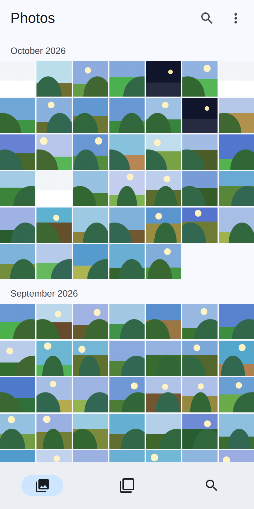 | 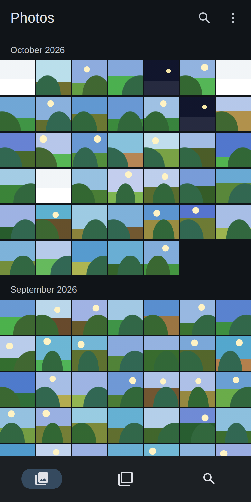 |
| Days | 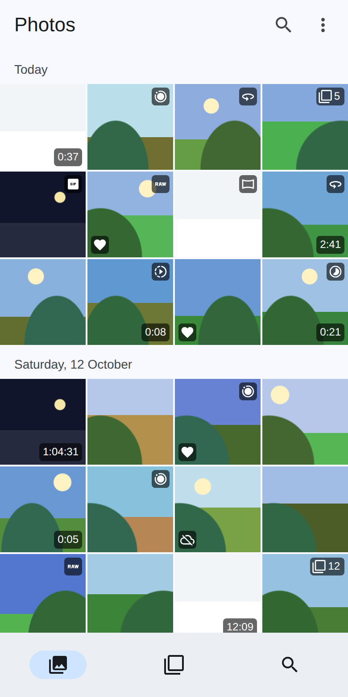 | 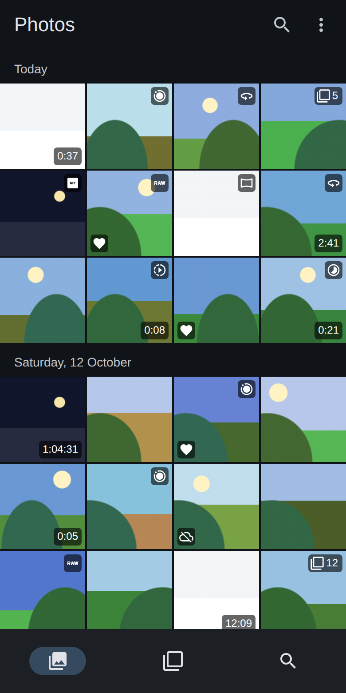 |
| Comfortable | 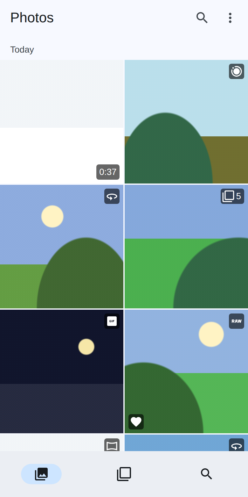 | 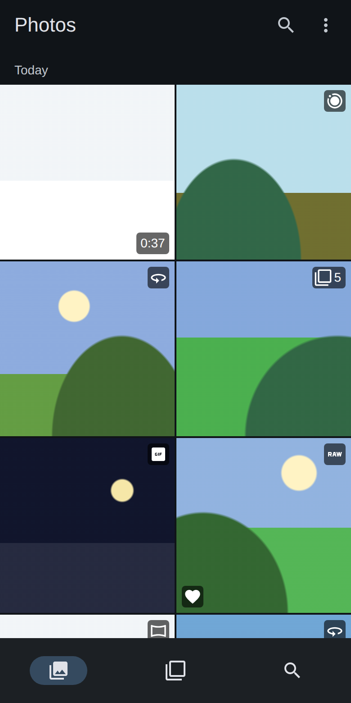 |

Rendered from [mockup.html](assets/0215/mockup.html):

```sh
google-chrome --headless=new --hide-scrollbars --force-device-scale-factor=2 --window-size=390,780 \
  --screenshot=mockup-days-dark.png "file://$PWD/docs/adr/assets/0215/mockup.html?density=days&theme=dark"
```

## Consequences

* A video, a Live or motion photo, a sphere, a panorama, an animated image and a RAW are recognisable in the grid and
  heard by a screen reader; M2-24 and stacks land in slots that already exist.
* The `timeline_item` view selects `facets`, `projection`, `duration_ms` and `favorite` (a schema step), and the kernel
  learns whether a GIF, WebP, PNG or AVIF is animated, which nothing reports today.
* The painter gains an atlas to rebuild on a pixel-ratio or text-scale change; durations stop laying out text per frame.
* The 21 languages (and the two pseudo-locales) gain the kind nouns and the setting's strings.

## Options considered

* **Copy Apple Photos** ([screenshot](assets/0215/apple-photos.jpg)): calm, but it hides exactly what the owner
  asked to see (Live, panoramas).
* **Copy Aves**: everything, switchable; its own users call the marks too big and turn them off one by one.
* **Copy Immich**: close to this proposal (glyphs top-right, favourite bottom-left), but no scrim, no hiding on the app,
  RAW and panoramas unmarked, the duration and kind sharing a corner, and the most "wrong mark" threads in the corpus.
* **This proposal**: Immich's slots made consistent, Fossify's pill made the rule, Aves' switches made one menu, and the
  screen reader told what the eye is shown.

## Hand-off: the implementation task

**Title**: [M1] Kind marks on timeline tiles: duration, Live and motion, 360° and panorama, animated, RAW, slow motion
and time-lapse, with a setting and spoken kinds

**Body**: Build ADR-0215's marks in `_RowPainter`. The `timeline_item` view selects `facets`, `projection`,
`duration_ms` and `favorite` (a schema step with its migration test); the timeline's pages carry each item's mark,
decided once by ADR-0215's precedence; RAW comes from the MIME type or extension (DNG, CR2, CR3, NEF, ARW, ORF, RW2,
PEF, RAF), animated from a new `ReadMetadataResponse.animated` (a GIF with two images, WebP's `ANIM`, PNG's `acTL`, an
AVIF sequence) with kernel vectors, stored as the `animated` facet. One atlas per pixel ratio and text scale holds the
glyphs on their pills and the duration's digits; a row draws them with one `drawAtlas` and its duration pills with one
`drawPath`, with the marks' own paints. Sizes, threshold, slots and contrast as ADR-0215 says. "Marks on tiles" in the
view menu and a switch per kind in Settings, stored with M1-32's view state. The cell's semantics label names the kind
first, also when the mark is hidden. Out of scope: stacks (M2), availability (M2-24), spatial (M7-05), the list view
(M1-15), which use the slots and nouns defined here.

**Acceptance**:

* Golden tests of a row at 55, 97 and 194 dp tiles, light, dark and right-to-left, show each kind's glyph in the top-end
  corner, the duration bottom-end and the favourite bottom-start, and nothing under 64 dp but the selection ring.
* A widget test per precedence pair (360° video, favourite RAW, Live and animated) shows one kind glyph.
* The pill's contrast with white text is at least 4.5:1 over a white tile (a test reads the composited pixels).
* `perf_test.dart`'s timeline scroll stays within its budget with every tile marked; a row issues at most two draws for
  its marks (a recording canvas counts them).
* The switches hide their kinds and survive a restart; the semantics label names the kind whether shown or not.
* The kernel's `animated` has vectors for GIF, WebP, PNG and AVIF, still and animated; the migration test covers the view.
* All launched languages carry the new strings.

**Size**: M.

**Dependencies**: M1-06 (photolib-design#52, facets; closed), M1-30 (photolib-design#462, the painter's own paints;
closed), M1-13 (photolib-design#60, `projection` in the replica), M1-32 (photolib-design#468, its view state and
settings; it gives up the GIF badge).

**M1-32**: move "a GIF badge on animated tiles with grid animation off by default" out of M1-32's body, keeping
"grid animation off by default" there, and change its acceptance "Animated tiles show a badge, grid animation is a
setting off by default" to "Grid animation is a setting off by default".

## Sources

| Product | Sources |
|---|---|
| Apple Photos | [ap1] iPhone User Guide: browse your photo library, View Options; [ap2] its library grid image (the screenshot); [ap3] its day image, three videos (the screenshot); [ap4] iCloud Shared Photo Library: "a badge in the top-right corner"; [ap5] Mac: "Live Photos have a badge in the top-left corner"; [ap7] media types; [ap8] Mac: bursts; [ap10] edited photos |
| Google Photos | [gp1] Play listing, whose screenshots show no mark; [gp2] backup status: "at the bottom right of each thumbnail"; [gp3] backup: the states of the mark; [gp4] 9to5Google, video previews (2019); [gp5] Android XR's spatial tab; [gp6] photo stacks; [gp7] HDR: "thumbnails in SDR"; [gp8] a user's screenshot of RAW marks (the screenshot, top); [gp9] the help page's backup animation (the screenshot, bottom) |
| Samsung Gallery | [sg1] "Favorite a picture or video in Picture Gallery", Galaxy S21 (the screenshot, top); [sg2] a dense grid on One UI 7 (the screenshot, bottom); [sg3] Samsung UK: how do I use the Gallery app |
| OneDrive | [od1] App Store iPad screenshot (the screenshot); [od2] Live Photos come to OneDrive; [od3] organise and find photos; [od4] roadmap round-up, July 2019 (360° photos); [od5] Play listing screenshot, a favourite's star; [od6] App Store iPad screenshot, shared albums |
| Amazon Photos | [am1] supported file types; [am2] forum: Live Photos play as stills; [am3] Play listing screenshot, a group's photos (the screenshot); [am4] forum: the web's favourite heart; [am5] forum: editing pictures; [am6] forum: the desktop app's backed-up check |
| Synology Photos | [sy1] Play listing screenshot (the screenshot); [sy2] Android app help: viewing, backup states; [sy3] DSM 7.2 Synology Photos specification; [sy4] albums: Similar Items; [sy5] release notes (Favorites in 1.9.0); [sy6] managing photos |
| Immich | [im1] web `Thumbnail.svelte`; [im2] web `VideoThumbnail.svelte`; [im3] app `thumbnail_tile.widget.dart`; [im4] web projection constants; [im5] web alt text; [im6] app "Show storage indicator"; [im8] the public demo (v3.3.4), captured 2026-10-21 |
| Ente | [en1] app `file_icons_widget.dart`; [en2] app `thumbnail_widget.dart`; [en3] web `FileList.tsx`; [en4] file types; [en5] Play listing image (the screenshot); [en6] grid size setting; [en7] `isPanorama`, read by the viewer only |
| PhotoPrism | [pp1] `cards.vue`; [pp2] `mosaic.vue`; [pp3] `list.vue`; [pp4] `views.css`; [pp5] `photo.js`; [pp6] sphere routing in the lightbox; [pp7] the public demo (261020-8e724ef17), captured 2026-10-21; [pp8] settings: the private feature; [pp9] HDR in file details |
| Nextcloud Memories | [nm1] `Photo.vue`; [nm2] flags; [nm3] panorama kinds; [nm4] settings; [nm5] `XImg.vue`, no alt; [nm6] the public demo, captured 2026-10-21 |
| Piwigo | [pw1] default `thumbnails.tpl`; [pw2] Darkroom `thumbnails.tpl`; [pw3] default `theme.css`; [pw4] Darkroom's hover bar; [pw5] the public demo, captured 2026-10-21; [pw6] the Media Icon plugin (#669) |
| LibrePhotos | [lp1] `VideoOverlay.tsx`; [lp2] `StackOverlay.tsx`; [lp3] `TopRightOverlay.tsx`; [lp4] `Tile.tsx`; [lp5] the tile's corners; [lp6] icon sizes; [lp7] media types; [lp8] rating style |
| Aves | [av1] grid `theme.dart`; [av2] `aves_icons.dart`; [av3] thumbnail `overlay.dart`; [av4] `icons.dart`; [av5] Settings › Thumbnails › Overlay; [av6] tile extent bounds; [av7] `entry.dart`; [av8] `decorated.dart`, no semantics; [av9] the screenshot: a tile of its build in deckerst/aves#2025 |
| Fossify Gallery | [fg1] `MediaAdapter.kt`; [fg2] `photo_item_grid.xml`; [fg3] `video_item_grid.xml`; [fg4] "Change file thumbnail style"; [fg5] `Medium.kt`; [fg6] panoramas in the viewer; [fg7] the duration's pill; [fg8] Commons dimensions; [fg9] the screenshot: its build in FossifyOrg/Gallery#7 |
| Simple Gallery | [sm1] `MediaAdapter.kt`; [sm2] `photo_item_grid.xml`; [sm3] `video_item_grid.xml`; [sm4] "Change file thumbnail style"; [sm5] panoramas in the viewer; [sm6] Commons dimensions; [sm7] the screenshot: its build in SimpleMobileTools/Simple-Gallery#2729 |

[ap1]: https://support.apple.com/guide/iphone/browse-your-photo-library-iph7d24753a5/ios
[ap2]: https://ipcdn-web.apple.com/assets/v2/web/94175a9b-b500-4ff3-a606-7110088976a5
[ap3]: https://ipcdn-web.apple.com/assets/v2/web/43f8e923-02d5-46a6-9b8d-30ee7f91acdd
[ap4]: https://support.apple.com/guide/iphone/use-icloud-shared-photo-library-iph1a6c849ab/ios
[ap5]: https://support.apple.com/guide/photos/view-photos-and-videos-pht8b9ba4aa9/mac
[ap7]: https://support.apple.com/guide/iphone/locate-photos-and-videos-by-media-type-iph8530ff6a2/ios
[ap8]: https://support.apple.com/guide/photos/view-photo-bursts-pht8745d2677/mac
[ap10]: https://support.apple.com/guide/iphone/find-receipts-qr-codes-edited-photos-iph995007f21/ios
[gp1]: https://play.google.com/store/apps/details?id=com.google.android.apps.photos
[gp2]: https://support.google.com/photos/answer/9343402
[gp3]: https://support.google.com/photos/answer/6193313
[gp4]: https://9to5google.com/2019/07/22/google-photos-video-previews/
[gp5]: https://support.google.com/photos/answer/16667814
[gp6]: https://support.google.com/photos/answer/14169846
[gp7]: https://support.google.com/photos/answer/14159275
[gp8]: https://github.com/immich-app/immich/discussions/21029
[gp9]: https://storage.googleapis.com/support-kms-prod/fw9QewbHBhbkr5WBTShs6QTHAj1Qv2l4CgjD
[sg1]: https://www.youtube.com/watch?v=MntDihbNTvo
[sg2]: https://www.youtube.com/watch?v=ya5E4J-ViVc
[sg3]: https://www.samsung.com/uk/support/mobile-devices/how-do-i-use-the-gallery-app/
[od1]: https://is1-ssl.mzstatic.com/image/thumb/PurpleSource211/v4/6e/f9/9e/6ef99e6e-8f09-f0e2-0dc4-aae5c0a7d17b/iPad-AppStore-Gallery.png/2048x0w.jpg
[od2]: https://techcommunity.microsoft.com/blog/onedriveblog/live-photos-come-to-onedrive/1953452
[od3]: https://support.microsoft.com/en-us/onedrive/organize-and-find-photos-in-onedrive
[od4]: https://techcommunity.microsoft.com/t5/microsoft-onedrive-blog/onedrive-roadmap-roundup-july-2019/ba-p/779616
[od5]: https://play-lh.googleusercontent.com/NfZg4NOPlVoUQRf4eCVsneGEqOzVZAXqbfX5MunF7Eong4ib4BdSfNMkBuSJ4vdvCQuXik3n8mnvGxh-98eMkg=w1052-h592-rw
[od6]: https://is1-ssl.mzstatic.com/image/thumb/PurpleSource221/v4/c4/c6/7f/c4c67fa3-08db-514e-00f5-2826f317f646/iPad-AppStore-Albums.png/1200x630wa.jpg
[am1]: https://www.amazon.com/gp/help/customer/display.html?nodeId=TXrlGPVwSuTJ16hHFn
[am2]: https://www.amazonforum.com/s/question/0D56Q0000B25LBzSQM/app-issue-with-live-photos
[am3]: https://play-lh.googleusercontent.com/13IuFjhAgzVQFem51aZPBLbqrLgguaetVc7_J45QVGRp9CCfkz9Apl-8tp4sc7tRvHbvg8TcOnu2JAiYTSTS=w1080
[am4]: https://www.amazonforum.com/s/question/0D56Q0000BjH8kQSQS/no-amazon-photos-web-app-favorite-feature
[am5]: https://www.amazonforum.com/s/question/0D5at00000ZwFmDCAV/how-to-edit-pictures-on-amazon-photos
[am6]: https://www.amazonforum.com/s/question/0D56Q0000AmRWPcSQO/amazon-photos-app-on-pc-not-backing-up-all-photos
[sy1]: https://play-lh.googleusercontent.com/E4UQDCEIKJjxUoLcph5TQOIguHFZZ-KBCtp3huZArBD6F1vZnXSwR43gVkwtQYn6VkCCCbR-6coK7uf_4-9svA=w1080
[sy2]: https://kb.synology.com/en-us/DSM/help/SynologyPhotos/Android?version=7
[sy3]: https://www.synology.com/en-us/dsm/7.2/software_spec/synology_photos
[sy4]: https://kb.synology.com/en-us/DSM/help/SynologyPhotos/managing_albums?version=7
[sy5]: https://www.synology.com/en-us/releaseNote/SynologyPhotos
[sy6]: https://kb.synology.com/en-us/DSM/help/SynologyPhotos/managing_photos?version=7
[im1]: https://github.com/immich-app/immich/blob/v3.3.4/web/src/lib/components/assets/thumbnail/Thumbnail.svelte#L255-L367
[im2]: https://github.com/immich-app/immich/blob/v3.3.4/web/src/lib/components/assets/thumbnail/VideoThumbnail.svelte#L92-L121
[im3]: https://github.com/immich-app/immich/blob/v3.3.4/mobile/lib/presentation/widgets/images/thumbnail_tile.widget.dart#L140-L337
[im4]: https://github.com/immich-app/immich/blob/v3.3.4/web/src/lib/constants.ts#L16-L21
[im5]: https://github.com/immich-app/immich/blob/v3.3.4/web/src/lib/utils/thumbnail-util.ts#L7-L52
[im6]: https://github.com/immich-app/immich/blob/v3.3.4/mobile/lib/widgets/settings/asset_list_settings/asset_list_settings.dart#L18-L26
[im8]: https://demo.immich.app
[en1]: https://github.com/ente/ente/blob/photos-v1.3.65/mobile/apps/photos/lib/ui/viewer/file/file_icons_widget.dart#L27-L240
[en2]: https://github.com/ente/ente/blob/photos-v1.3.65/mobile/apps/photos/lib/ui/viewer/file/thumbnail_widget.dart#L201-L204
[en3]: https://github.com/ente/ente/blob/photos-v1.3.65/web/apps/photos/src/components/FileList.tsx#L1085-L1330
[en4]: https://github.com/ente/ente/blob/photos-v1.3.65/web/packages/media/file-type.ts#L1
[en5]: https://play-lh.googleusercontent.com/Bx69lKhb6DON8TgI9qZO2z3Ei652lSCww0yXgdwvvM0mFQ_l5DKkFqYG1Ru_fvnI1LuqIR1TGxnuvyq6WuwpLw0=w2560
[en6]: https://github.com/ente/ente/blob/photos-v1.3.65/mobile/apps/photos/lib/ui/settings/gallery_settings_screen.dart#L71-L77
[en7]: https://github.com/ente/ente/blob/photos-v1.3.65/mobile/apps/photos/lib/models/file/extensions/file_props.dart#L21-L28
[pp1]: https://github.com/photoprism/photoprism/blob/261007-65faaae5d/frontend/src/component/photo/view/cards.vue#L111-L157
[pp2]: https://github.com/photoprism/photoprism/blob/261007-65faaae5d/frontend/src/component/photo/view/mosaic.vue#L40-L71
[pp3]: https://github.com/photoprism/photoprism/blob/261007-65faaae5d/frontend/src/component/photo/view/list.vue#L82-L122
[pp4]: https://github.com/photoprism/photoprism/blob/261007-65faaae5d/frontend/src/css/views.css#L423-L917
[pp5]: https://github.com/photoprism/photoprism/blob/261007-65faaae5d/frontend/src/model/photo.js#L58
[pp6]: https://github.com/photoprism/photoprism/blob/261007-65faaae5d/frontend/src/component/lightbox.vue#L750-L760
[pp7]: https://demo.photoprism.app/library/browse
[pp8]: https://github.com/photoprism/photoprism/blob/261007-65faaae5d/frontend/src/page/settings/general.vue#L200-L201
[pp9]: https://github.com/photoprism/photoprism/blob/261007-65faaae5d/frontend/src/component/photo/edit/files.vue#L232-L234
[nm1]: https://github.com/pulsejet/memories/blob/v10.1.0/src/components/frame/Photo.vue#L19-L49
[nm2]: https://github.com/pulsejet/memories/blob/v10.1.0/src/services/constants.ts#L8-L14
[nm3]: https://github.com/pulsejet/memories/blob/v10.1.0/lib/Exif.php#L313-L327
[nm4]: https://github.com/pulsejet/memories/blob/v10.1.0/src/components/Settings.vue#L49-L71
[nm5]: https://github.com/pulsejet/memories/blob/v10.1.0/src/components/frame/XImg.vue#L6-L28
[nm6]: https://demo.memories.gallery/apps/memories/
[pw1]: https://github.com/Piwigo/Piwigo/blob/16.4.0/themes/default/template/thumbnails.tpl#L36-L57
[pw2]: https://github.com/Piwigo/piwigo-bootstrap-darkroom/blob/2.4.4/template/thumbnails.tpl#L29-L31
[pw3]: https://github.com/Piwigo/Piwigo/blob/16.4.0/themes/default/theme.css#L348-L352
[pw4]: https://github.com/Piwigo/piwigo-bootstrap-darkroom/blob/2.4.4/scss/theme/_plugin-fixes.scss#L108-L128
[pw5]: https://demo1.piwigo.com/index.php?/most_visited
[pw6]: https://github.com/Piwigo/Piwigo/issues/669
[lp1]: https://github.com/LibrePhotos/librephotos/blob/1.4.0/apps/frontend/src/components/photolist/VideoOverlay.tsx#L17-L47
[lp2]: https://github.com/LibrePhotos/librephotos/blob/1.4.0/apps/frontend/src/components/photolist/StackOverlay.tsx#L8-L52
[lp3]: https://github.com/LibrePhotos/librephotos/blob/1.4.0/apps/frontend/src/components/photolist/TopRightOverlay.tsx#L13-L62
[lp4]: https://github.com/LibrePhotos/librephotos/blob/1.4.0/apps/frontend/src/components/react-pig/components/Tile/Tile.tsx#L121-L260
[lp5]: https://github.com/LibrePhotos/librephotos/blob/1.4.0/apps/frontend/src/components/react-pig/components/Tile/styles.module.css#L128-L163
[lp6]: https://github.com/LibrePhotos/librephotos/blob/1.4.0/apps/frontend/src/uiConstants.ts#L9-L15
[lp7]: https://github.com/LibrePhotos/librephotos/blob/1.4.0/packages/api-client/src/schemas/common.ts#L52-L56
[lp8]: https://github.com/LibrePhotos/librephotos/blob/1.4.0/apps/frontend/src/components/settings/MetadataOptionsCard.tsx#L61-L83
[av1]: https://github.com/deckerst/aves/blob/v1.15.7/lib/widgets/common/grid/theme.dart#L22-L110
[av2]: https://github.com/deckerst/aves/blob/v1.15.7/lib/widgets/common/identity/aves_icons.dart#L107-L275
[av3]: https://github.com/deckerst/aves/blob/v1.15.7/lib/widgets/common/thumbnail/overlay.dart#L13-L29
[av4]: https://github.com/deckerst/aves/blob/v1.15.7/lib/theme/icons.dart#L219-L229
[av5]: https://github.com/deckerst/aves/blob/v1.15.7/lib/widgets/settings/thumbnails/overlay_page.dart#L20-L130
[av6]: https://github.com/deckerst/aves/blob/v1.15.7/lib/widgets/collection/collection_grid.dart#L65-L66
[av7]: https://github.com/deckerst/aves/blob/v1.15.7/lib/model/entry/entry.dart#L265-L328
[av8]: https://github.com/deckerst/aves/blob/v1.15.7/lib/widgets/common/thumbnail/decorated.dart
[av9]: https://github.com/deckerst/aves/issues/2025
[fg1]: https://github.com/FossifyOrg/Gallery/blob/1.14.0/app/src/main/kotlin/org/fossify/gallery/adapters/MediaAdapter.kt#L658-L712
[fg2]: https://github.com/FossifyOrg/Gallery/blob/1.14.0/app/src/main/res/layout/photo_item_grid.xml#L15-L60
[fg3]: https://github.com/FossifyOrg/Gallery/blob/1.14.0/app/src/main/res/layout/video_item_grid.xml#L15-L49
[fg4]: https://github.com/FossifyOrg/Gallery/blob/1.14.0/app/src/main/kotlin/org/fossify/gallery/dialogs/ChangeFileThumbnailStyleDialog.kt#L17-L29
[fg5]: https://github.com/FossifyOrg/Gallery/blob/1.14.0/app/src/main/kotlin/org/fossify/gallery/models/Medium.kt
[fg6]: https://github.com/FossifyOrg/Gallery/blob/1.14.0/app/src/main/kotlin/org/fossify/gallery/fragments/PhotoFragment.kt#L828-L848
[fg7]: https://github.com/FossifyOrg/Gallery/blob/1.14.0/app/src/main/res/drawable/darkened_automatic_circle_background.xml
[fg8]: https://github.com/FossifyOrg/Commons/blob/7.1.2/commons/src/main/res/values/dimens.xml
[fg9]: https://github.com/FossifyOrg/Gallery/issues/7
[sm1]: https://github.com/SimpleMobileTools/Simple-Gallery/blob/6.28.1/app/src/main/kotlin/com/simplemobiletools/gallery/pro/adapters/MediaAdapter.kt#L618-L650
[sm2]: https://github.com/SimpleMobileTools/Simple-Gallery/blob/6.28.1/app/src/main/res/layout/photo_item_grid.xml#L15-L52
[sm3]: https://github.com/SimpleMobileTools/Simple-Gallery/blob/6.28.1/app/src/main/res/layout/video_item_grid.xml#L15-L44
[sm4]: https://github.com/SimpleMobileTools/Simple-Gallery/blob/6.28.1/app/src/main/kotlin/com/simplemobiletools/gallery/pro/dialogs/ChangeFileThumbnailStyleDialog.kt
[sm5]: https://github.com/SimpleMobileTools/Simple-Gallery/blob/6.28.1/app/src/main/kotlin/com/simplemobiletools/gallery/pro/fragments/PhotoFragment.kt#L747-L766
[sm6]: https://github.com/SimpleMobileTools/Simple-Commons/blob/9e60e24790/commons/src/main/res/values/dimens.xml
[sm7]: https://github.com/SimpleMobileTools/Simple-Gallery/issues/2729
[Aves #1771]: https://github.com/deckerst/aves/issues/1771
[Aves #1984]: https://github.com/deckerst/aves/issues/1984
[Aves #2219]: https://github.com/deckerst/aves/issues/2219
[Aves #240]: https://github.com/deckerst/aves/issues/240
[Aves #472]: https://github.com/deckerst/aves/issues/472
[Aves #68]: https://github.com/deckerst/aves/issues/68
[Aves #859]: https://github.com/deckerst/aves/issues/859
[Damselfly #426]: https://github.com/Webreaper/Damselfly/issues/426
[Ente #528]: https://github.com/ente/ente/issues/528
[Ente D12065]: https://github.com/ente/ente/discussions/12065
[Ente D12392]: https://github.com/ente/ente/discussions/12392
[Ente D12853]: https://github.com/ente/ente/discussions/12853
[Ente D1770]: https://github.com/ente/ente/discussions/1770
[Ente D2829]: https://github.com/ente/ente/discussions/2829
[Ente D6434]: https://github.com/ente/ente/discussions/6434
[Ente D6656]: https://github.com/ente/ente/discussions/6656
[Fossify #428]: https://github.com/FossifyOrg/Gallery/issues/428
[Fossify #505]: https://github.com/FossifyOrg/Gallery/issues/505
[Fossify #7]: https://github.com/FossifyOrg/Gallery/issues/7
[Fossify #970]: https://github.com/FossifyOrg/Gallery/issues/970
[Immich #10213]: https://github.com/immich-app/immich/issues/10213
[Immich #14548]: https://github.com/immich-app/immich/issues/14548
[Immich #17663]: https://github.com/immich-app/immich/issues/17663
[Immich #18575]: https://github.com/immich-app/immich/issues/18575
[Immich #18625]: https://github.com/immich-app/immich/issues/18625
[Immich #18828]: https://github.com/immich-app/immich/issues/18828
[Immich #20139]: https://github.com/immich-app/immich/issues/20139
[Immich #20249]: https://github.com/immich-app/immich/issues/20249
[Immich #20955]: https://github.com/immich-app/immich/issues/20955
[Immich #21968]: https://github.com/immich-app/immich/issues/21968
[Immich #22366]: https://github.com/immich-app/immich/issues/22366
[Immich #22564]: https://github.com/immich-app/immich/issues/22564
[Immich #22573]: https://github.com/immich-app/immich/issues/22573
[Immich #23252]: https://github.com/immich-app/immich/issues/23252
[Immich #24135]: https://github.com/immich-app/immich/issues/24135
[Immich #24652]: https://github.com/immich-app/immich/issues/24652
[Immich #26181]: https://github.com/immich-app/immich/issues/26181
[Immich #28795]: https://github.com/immich-app/immich/issues/28795
[Immich #571]: https://github.com/immich-app/immich/issues/571
[Immich D11688]: https://github.com/immich-app/immich/discussions/11688
[Immich D11899]: https://github.com/immich-app/immich/discussions/11899
[Immich D14852]: https://github.com/immich-app/immich/discussions/14852
[Immich D15448]: https://github.com/immich-app/immich/discussions/15448
[Immich D16144]: https://github.com/immich-app/immich/discussions/16144
[Immich D1621]: https://github.com/immich-app/immich/discussions/1621
[Immich D17011]: https://github.com/immich-app/immich/discussions/17011
[Immich D17143]: https://github.com/immich-app/immich/discussions/17143
[Immich D17859]: https://github.com/immich-app/immich/discussions/17859
[Immich D20980]: https://github.com/immich-app/immich/discussions/20980
[Immich D21029]: https://github.com/immich-app/immich/discussions/21029
[Immich D21653]: https://github.com/immich-app/immich/discussions/21653
[Immich D22136]: https://github.com/immich-app/immich/discussions/22136
[Immich D22273]: https://github.com/immich-app/immich/discussions/22273
[Immich D22731]: https://github.com/immich-app/immich/discussions/22731
[Immich D22747]: https://github.com/immich-app/immich/discussions/22747
[Immich D23335]: https://github.com/immich-app/immich/discussions/23335
[Immich D23655]: https://github.com/immich-app/immich/discussions/23655
[Immich D25347]: https://github.com/immich-app/immich/discussions/25347
[Immich D26394]: https://github.com/immich-app/immich/discussions/26394
[Immich D28332]: https://github.com/immich-app/immich/discussions/28332
[Immich D31486]: https://github.com/immich-app/immich/discussions/31486
[Immich D6190]: https://github.com/immich-app/immich/discussions/6190
[Immich D6267]: https://github.com/immich-app/immich/discussions/6267
[Immich D8027]: https://github.com/immich-app/immich/discussions/8027
[LibrePhotos #2243]: https://github.com/LibrePhotos/librephotos/issues/2243
[LibrePhotos #2245]: https://github.com/LibrePhotos/librephotos/issues/2245
[LibrePhotos #308]: https://github.com/LibrePhotos/librephotos/issues/308
[Memories #1402]: https://github.com/pulsejet/memories/issues/1402
[Memories #1417]: https://github.com/pulsejet/memories/issues/1417
[Memories #1535]: https://github.com/pulsejet/memories/issues/1535
[Memories #479]: https://github.com/pulsejet/memories/issues/479
[Memories #898]: https://github.com/pulsejet/memories/issues/898
[Memories #955]: https://github.com/pulsejet/memories/issues/955
[Nextcloud Photos #3472]: https://github.com/nextcloud/photos/issues/3472
[Nextcloud Photos #417]: https://github.com/nextcloud/photos/issues/417
[PhotoPrism #307]: https://github.com/photoprism/photoprism/issues/307
[PhotoPrism #467]: https://github.com/photoprism/photoprism/issues/467
[PhotoPrism D2765]: https://github.com/photoprism/photoprism/discussions/2765
[PhotoPrism D4040]: https://github.com/photoprism/photoprism/discussions/4040
[PiGallery2 #1047]: https://github.com/bpatrik/pigallery2/issues/1047
[Simple Gallery #1097]: https://github.com/SimpleMobileTools/Simple-Gallery/issues/1097
[Simple Gallery #1719]: https://github.com/SimpleMobileTools/Simple-Gallery/issues/1719
[Simple Gallery #2729]: https://github.com/SimpleMobileTools/Simple-Gallery/issues/2729
