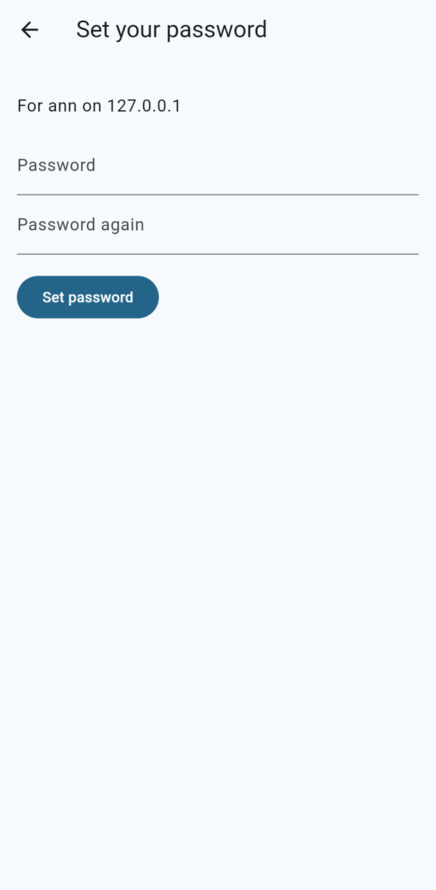
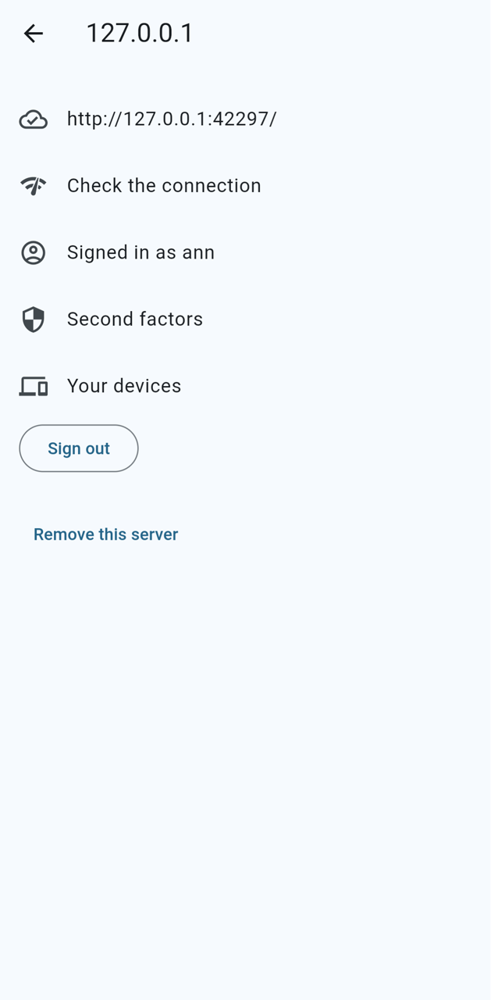
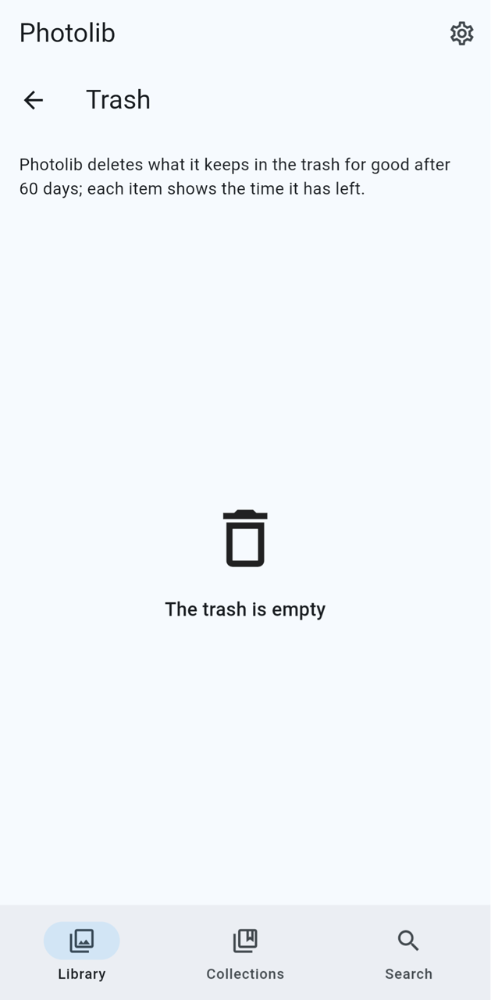
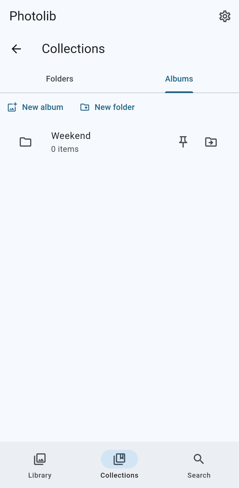

# ADR-0386 — Organisation v1: trash, retention, emptying through the intent log, albums made on devices, per-surface hiding

* **Status**: **Proposed — owner to confirm**.
* **Requirements**: F-14, R-REL-1; feature `ORG-17`. **Design**:
  sync §5,
  domain model §4, §5,
  storage §6,
  [ADR-0022](0022-object-store-backends.md), [ADR-0041](0041-journaled-file-operations.md), [ADR-0257](0257-external-change-detection.md),
  [ADR-0265](0265-mutations-outbox-merge.md).

## Context

Favourites (`asset_user_state`), archive, trash and album membership already reach the server as mutations
(ADR-0265). Missing were the end of the trash (what deletes the files and objects, and when), albums that a device made
before it had an account, and the per-surface hiding of an album or a library. The item names no retention, no
confirmation threshold and no rule for a file two assets name; the design documents it cites are not in this
repository.

## Decision

* **Trash** is the `trashed_at` field (ADR-0265). Nothing deletes a file while an asset is only trashed.
* **Emptying** is `SyncService.EmptyTrash` (capability `sync.trash.v1`). It counts the caller's own trashed assets of
  standard and managed libraries, through `scope` for deleting, and asks `guard::Dry` (ADR-0257): over 1,000 assets or
  5 % of the account it deletes nothing and answers the count, the total and a token that names that count and the
  newest trashing; the same call with the token queues the `trash-empty` job, which deletes only what was trashed up to
  that instant. The app asks once with the count and again with the server's when it holds the trash back.
* **Deleting** is one transaction per asset: a delete intent for each file no other asset names (a shared key stays),
  then the asset's rows and the intents' switch commit together, then the files go (`Journal::delete`, ADR-0041). A
  crash before the commit leaves everything; after it, recovery completes the switched intents. So no row outlives its
  file and no file its row (`trash::tests`, killed with SIGKILL at each step). Nothing relies on bucket versioning or
  object lock (ADR-0022).
* **Retention**: the `trash-expire` job, daily at 04:30, deletes in the same way what stayed in the trash longer than
  the console's `trash_retention_days` (30 unless an administrator sets or pins it).
* **Tombstones**: deleting a row leaves sync's tombstone (ADR-0053), so every device drops the asset on its next sync,
  and a stale device's later edit, restore, favourite or album add of it is `mutation.not_found` and creates no row.
* **External libraries** are never written, and their next scan would find the file again: their trashed assets are
  not emptied, they stay in the trash.
* **Albums made on devices**: a `FieldEdit` of entity `albums` (`title`, `description`) creates the album for the
  caller under the device's UUID when no album has it, and merges by clock afterwards; the contents are the usual
  `MemberEdit`s. The app's `Mutations.adoptAlbums` replays each album of the nil owner once every item is on the server
  (the `asset_id` of its device item), before each push.
* **Per-surface hiding** (ORG-17): `album_user_state` and `library_user_state` (`hide_from_timeline`,
  `hide_from_memories`) are the account's own fields, set by field edit with `View`. Triggers keep two columns on the
  account's `asset_user_state` (`album_hides_timeline`, `album_hides_memories`) true while the asset is in an album
  the account hides, so the timeline summary reads one primary-key row and joins no album. Library hiding is one
  lookup by library, as before.

## Consequences

* Emptying and expiring are bulk deletions: they run as jobs on `worker:io`, a store that is offline fails the job
  and it is tried again.
* A device that still holds a purged file and backs it up uploads it as a new asset: the server keeps no hash of what
  was emptied. Owner to decide whether it should.
* The retention is not guarded by `Dry` (the user had the retention's days); owner to decide.
* The memories and search consumers of `album_hides_memories` arrive with those features.
* The app's replica (schema 29) keeps both states and the two derived columns; its cloud tiles and the tile of a
  device item leave the timeline by lookups and triggers. An album's Hide menu sets its two flags; the app has no screen
  for libraries yet, so a library's flags are set through the outbox only.

## Screenshots

The web build in Chrome with Pixel 7 emulation (touch, 4x CPU throttle, 1.5 Mbit/s), signed in to a real photolibd
through a password setup link; each is a screenshot of the app itself, scaled to 1280 px high. The web app has no sync
worker yet (ADR-0120), so the server's albums and trash reach no browser; the Hide menu and the trash count are
widget-tested (`album_hiding_test.dart`, `trash_test.dart`).

| Set your password | Signed in | Trash | Albums, one made on the device |
|---|---|---|---|
|  |  |  |  |

## Options considered

* A synchronous `EmptyTrash`: a large trash would hold a request open for minutes and a crash would lose the loop.
* Deleting files before the rows: a crash would leave rows without files, which the scrub reports as damage.
* Joining `album_user_state` in the timeline query: what ORG-17 rules out.
* A hash tombstone against re-uploads: a privacy and product decision, not made here.
